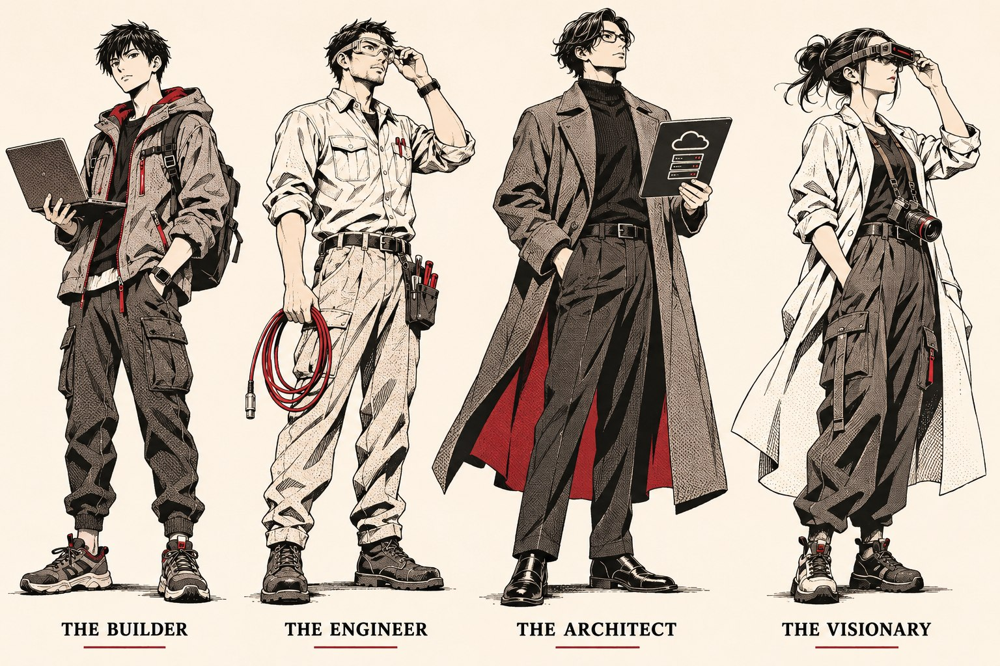
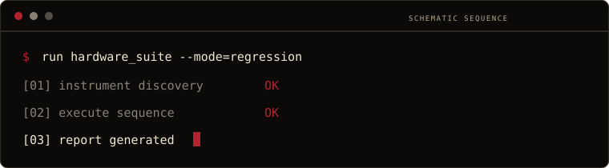
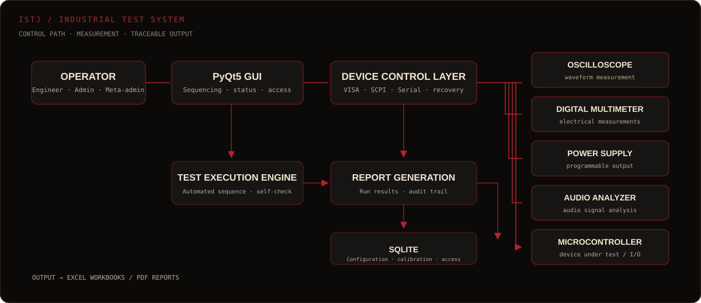
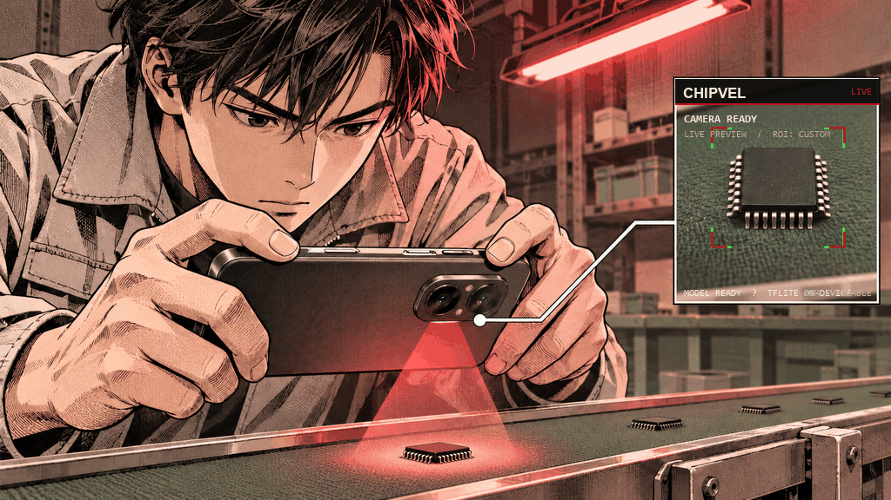
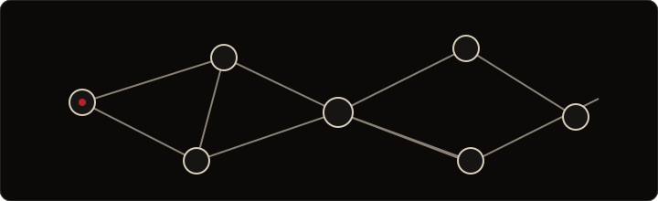
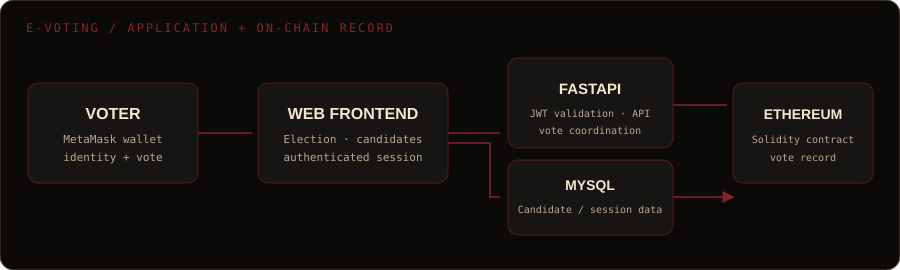
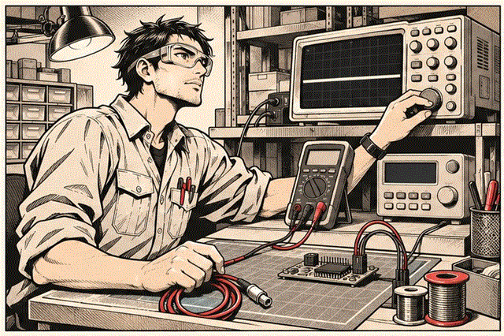
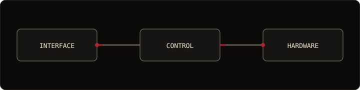
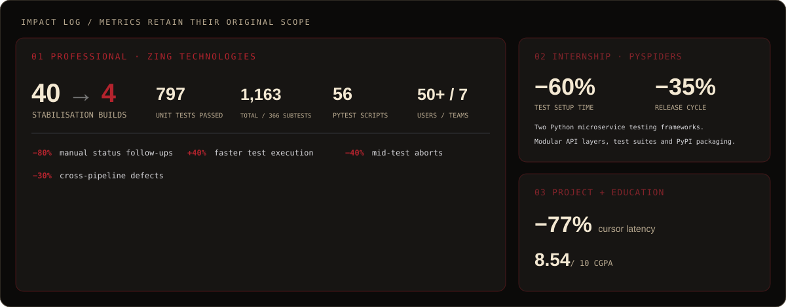

<div align="center">

<p align="center">
  
</p>

# PROJECT KŌDAN
### THE ENGINEERING CHRONICLES

**Software engineering · hardware automation · systems that move**

<a href="https://github.com/Itskoushik">GITHUB</a> ·
<a href="https://linkedin.com/in/itskoushikram">LINKEDIN</a> ·
<a href="mailto:koushik.d.ram@gmail.com">EMAIL</a> ·
<a href="https://x.com/koushik_ram18">X</a>

</div>

> A manga-inspired chronicle of real engineering work: automation, test systems, computer vision, and projects that inspire and connect.


## CHAPTER 01 — THE DEVELOPER

<div align="center">
<p align="center">
  
</p>
</div>

I’m **Koushik Ram**, a Software Engineer at **Zing Technologies** in Bengaluru. I build software that connects people, services and hardware—from multi-threaded instrument control to serverless task platforms.



```text
CURRENT ROLE   Software Engineer · Zing Technologies
ENGINEERING    Python · hardware test automation · backend · cloud
PURSUIT        Reliable systems with useful, testable interfaces
```

## CHAPTER 02 — THE ARSENAL

<div align="center">

</div>

| Discipline | Tools in the kit |
|---|---|
| **Languages** | Python · JavaScript · TypeScript · Java · C/C++ · SQL |
| **Frameworks** | PyQt5 · FastAPI · React · Next.js · Node.js |
| **Data** | MySQL · MongoDB · SQLite · DynamoDB |
| **Cloud & delivery** | AWS Lambda · GCP · Docker · Kubernetes · Jenkins · GitHub Actions |
| **Testing** | pytest · Selenium · Postman |
| **Computer vision** | OpenCV · MediaPipe |
| **Blockchain** | Ethereum · Solidity |
| **Next character development** | LLMs · RAG · LangChain · LangGraph · LangSmith · CrewAI · n8n · multi-agent systems · semantic search · embeddings · vector databases (exploring) |

Certifications: Microsoft Azure AI Essentials · Google Cloud Foundations & Generative AI · Databricks Fundamentals.

## CHAPTER 03 — THE MISSIONS

### MISSION 01 · ISTJ — Integrated System Test Jig

**Industrial hardware test automation** · `Python` `PyQt5` `SQLite` `VISA` `SCPI` `Serial`

Built for structured testing on HAL’s ALH helicopter programme. ISTJ coordinates lab instruments, guides automated test sequences, checks equipment health and produces Excel/PDF reports through a role-based desktop application.

<div align="center">

</div>

- Multi-threaded control and device recovery across oscilloscopes, digital multimeters, power supplies, audio analyzers and microcontrollers.
- Automated sequences, equipment self-checks, calibration records, device discovery/recovery and engineer/admin/meta-admin roles.
- Stabilisation builds fell from **40 to 4** across four releases. The latest fresh unit-test run passed **797 test cases** and **366 subtests** (**1,163 total executions**); the project includes **56 pytest regression scripts**.
- Reported outcomes: **40% fewer mid-test aborts**, **40% faster test execution**, **30% fewer cross-pipeline defects**, and zero critical defects from release 3 through sign-off.



**[Explore the ISTJ source →](https://github.com/Itskoushik/ISTJ_test_jig)**

### MISSION 02 — CHIPVEL: THE INSPECTION ARC

**AUTOMATED CHIP INSPECTION** · `Kotlin` `Jetpack Compose` `Material 3` `CameraX` `TensorFlow Lite` `Room` `DataStore` `Kotlin Coroutines`

CHIPVEL is an Android application for camera-based electronic-chip inspection in a conveyor workflow. Its on-device TensorFlow Lite model detects chips and their markings, then applies inspection rules and presents a clear PASS or FAIL result to the operator.

<p align="center">
  
</p>

- CameraX live inspection with a configurable inspection region and stable-scene checks.
- Chip and marking detection overlays, rule-based evaluation, and distinct PASS/FAIL outcomes.
- Optional buzzer and voice announcements, local inspection history, and model diagnostics/performance information.
- Simulation mode for workflow testing, separate from live camera inspection.

**[Explore the CHIPVEL source →](https://github.com/Itskoushik/chipwell_v1)**

### MISSION 03 · EyeCue-IntelliSense

**Computer vision · human-computer interaction** · `Python` `OpenCV` `MediaPipe` `PyAutoGUI`

Touch-free computer interaction: gaze moves the cursor; hand gestures trigger clicks and scrolling.

<p align="center">
  
</p>

The project reports **77% lower cursor latency** after retraining on a cleaner dataset.

**[Explore EyeCue source →](https://github.com/Itskoushik/EyeCue-IntelliSense)**

### MISSION 04 · E-Voting System

**Blockchain · full stack** · `Ethereum` `Solidity` `FastAPI` `MySQL` `JWT`

An election app combining authenticated voter access and application data with vote recording through an Ethereum smart contract and MetaMask.

<p align="center">
  
</p>





**[Explore E-Voting source →](https://github.com/Itskoushik/E-Voting-System)**

### MISSION 05 · Zorofy

**Music discovery and playback · Full stack** · `Next.js 14` `React 18` `Tailwind CSS` `Node.js` `MongoDB` `Mongoose` `NextAuth.js` `Redux Toolkit` `YouTube Data API v3` `YouTube IFrame Player API`

Responsive music discovery for Indian and international music, bringing regional discovery, charts, new releases, playlists, search and playback into one listening experience.

- Search music videos, playlists and artists with debounced requests, pagination and quota-aware caching.
- Browse playlist tracks and play a queue using the official YouTube embedded player.
- Email/password sign-in, optional Google sign-in, favourites and saved playlists.
- Playback does not extract direct audio URLs, download media or bypass platform restrictions.

**[Explore the Zorofy source](https://github.com/Itskoushik/zorofy)** · **[Live demo](https://zorofy.netlify.app/)**

## CHAPTER 04 — THE ENGINEERING LAB

<div align="center">
<p align="center">
  
</p>
</div>

At Zing Technologies, ISTJ work joined a PyQt5 interface to VISA/SCPI and serial device control. A separate AWS Lambda task platform, built with Python and MongoDB, serves **50+ users across 7 teams** and reduced manual status follow-ups by **80%**.




## CHAPTER 05 — THE IMPACT



During my **Pyspiders** internship, Two Python microservice testing frameworks, modular API layers, test suites and PyPI packaging cut test setup time by **60%**. Release cycles were **35% shorter**. My B.E. CGPA was **8.54 / 10**. These internship and education figures are separate from the Zing Technologies outcomes above.

## CHAPTER 06 — THE JOURNEY

| When | Chapter |
|---|---|
| **Aug 2025 — Present** | **Software Engineer · Zing Technologies**, Bengaluru — hardware automation, backend/serverless systems and test engineering. Delivered ISTJ for HAL’s ALH programme; onboarded operators at HAL; mentored two interns. |
| **Jun — Jul 2025** | **Software Engineer Intern · Pyspiders** — two Python microservice testing frameworks with PyPI packaging; CI/CD using Jenkins, Docker, Kubernetes and GitHub Actions. |
| **Dec 2021 — Jul 2025** | **B.E. Information Science & Engineering · MVJ College of Engineering**, Bengaluru — CGPA **8.54 / 10**. |

## CHAPTER 07 — NEXT ARC

- **RAG & LLM engineering** — Deepening my exploration of **Large Language Models (LLMs), Retrieval-Augmented Generation (RAG), and AI-powered application development.**
- **Backend & AI application development** — Exploring **semantic search, embedding models, vector databases, retrieval pipelines, and context-aware AI systems.**
- **DevOps & cloud infrastructure** — Building stronger foundations in **DevOps, CI/CD, Docker, Kubernetes, cloud infrastructure, and automated deployment workflows.**

**OPEN TO** Software Engineer opportunities involving backend engineering, AI-driven products, LLM applications, and scalable cloud-native systems.

## FINAL CHAPTER — BUILD. BREAK. UNDERSTAND. REBUILD.

<div align="center">

<p align="center">
  
</p>

<a href="https://github.com/Itskoushik">GitHub</a> · <a href="https://linkedin.com/in/itskoushikram">LinkedIn</a> · <a href="mailto:koushik.d.ram@gmail.com">Email</a> · <a href="https://x.com/koushik_ram18">X</a>


</div>
